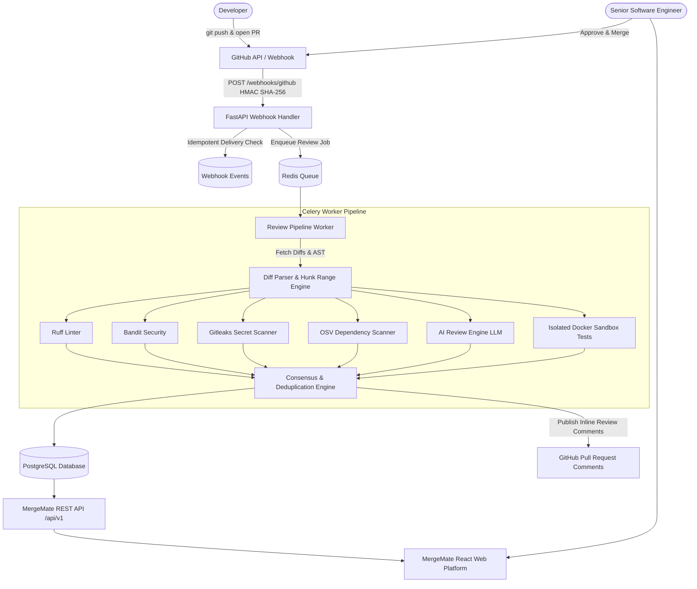

# MergeMate Architecture Specification

## 1. Executive Overview

MergeMate is an enterprise-grade AI-powered Pull Request Review Assistant designed as a high-throughput, multi-engine code analysis platform. It inserts an automated review and verification layer between pull request creation on GitHub and human merge authority.

## 2. Core Modules

### 2.1 Webhook & Ingestion Layer
- **HMAC Verification**: Every incoming webhook payload is checked using `X-Hub-Signature-256` HMAC SHA-256.
- **Idempotency**: Webhook `delivery_id` is tracked in PostgreSQL. Duplicates or replay deliveries are skipped immediately.
- **Asynchronous Handoff**: The webhook endpoint enqueues a background Celery task and responds within 50ms.

### 2.2 Diff Parsing & Context Engine
- Parses unified git diffs into structured hunk representations.
- Extracts additions (`+`), deletions (`-`), and context lines.
- Records exact set of newly introduced line numbers per file, ensuring inline comments target only modified code.

### 2.3 Multi-Engine Analysis Consensus
1. **Ruff Adapter**: Checks AST violations, mutable argument defaults, wildcard imports, and stylistic defects.
2. **Bandit Adapter**: Detects dangerous serialization (`pickle`), unsafe `yaml.load`, and production assertions.
3. **Gitleaks Adapter**: Regex and entropy-based credential detection. All detected secrets are masked with `mask_secret` prior to persistence.
4. **OSV Adapter**: Matches dependencies against open source vulnerability databases (CVEs).
5. **AI Review Engine**: Provider-agnostic LLM interface with prompt injection defenses and Pydantic schema validation.

### 2.4 Isolated Ephemeral Sandbox Runner
- Test suites run inside ephemeral non-root containers (`user 1000:1000`).
- Strict quotas: `512MB` memory limit, `1.0 CPU` cap, `--network none`, execution timeout `60s`.
- Automatic container cleanup (`--rm`).

### 2.5 GitHub Review Publisher
- Formats structured review summaries with markdown tables, severity counts, and shields.
- Posts inline review comments directly to the GitHub PR matching diff line positions.

