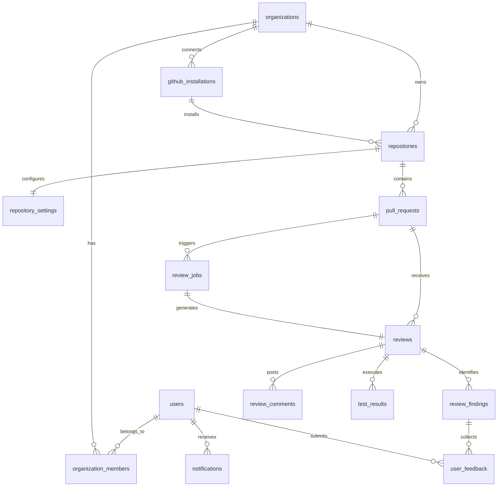

# MergeMate Database Design Specification

## 1. Schema Overview

MergeMate utilizes PostgreSQL with SQLAlchemy 2.0 ORM and Alembic schema migrations.

## 2. Table Catalog

| Table Name | Description | Key Indexes / Constraints |
| :--- | :--- | :--- |
| `users` | User accounts, credentials, and profile metadata. | `email` (UNIQUE), `github_username` |
| `organizations` | Multi-tenant organization boundaries. | `slug` (UNIQUE) |
| `organization_members` | Organization memberships and role assignments (owner, admin, developer, viewer). | `(organization_id, user_id)` (UNIQUE) |
| `github_installations` | Installed GitHub App instances and permission grants. | `installation_id` (UNIQUE) |
| `repositories` | Connected git repositories monitored by MergeMate. | `github_repo_id` (UNIQUE), `full_name` (UNIQUE) |
| `repository_settings` | Review engine toggles, severity thresholds, custom instructions. | `repository_id` (UNIQUE) |
| `pull_requests` | Pull requests opened or synchronized across connected repos. | `(repository_id, pr_number)` (INDEX), `head_sha` |
| `review_jobs` | Background task execution state machine (`PENDING`, `QUEUED`, `PROCESSING`, `COMPLETED`, `FAILED`). | `commit_sha`, `status` |
| `reviews` | Review outcomes, verdicts (`APPROVE`, `REQUEST_CHANGES`, `COMMENT`), durations, and counts. | `review_job_id` (UNIQUE) |
| `review_findings` | Normalized findings across AI, Ruff, Bandit, Gitleaks, OSV. | `review_id`, `file_path`, `severity` |
| `review_comments` | Inline comments posted to GitHub diff positions. | `review_id`, `file_path`, `line` |
| `test_results` | Containerized test suite metrics and output logs. | `review_id`, `passed` |
| `webhook_events` | Idempotency log of raw inbound GitHub delivery payloads. | `delivery_id` (UNIQUE) |
| `notifications` | In-app alerts for users and organizations. | `user_id`, `read` |
| `audit_logs` | Audit trail of administrative and security events. | `user_id`, `action`, `created_at` |
| `user_feedback` | Reviewer triage feedback (`useful`, `incorrect`, `ignored`). | `finding_id`, `user_id` |

## 3. Retention & Privacy Policies
- **Source Code**: Raw source code is never permanently stored on disk; diff context is ephemeral and purged upon review completion.
- **Secret Redaction**: Gitleaks and AI detectors mask credentials prior to persisting code evidence in `review_findings`.
